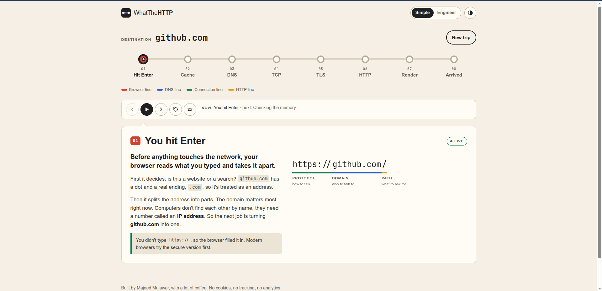
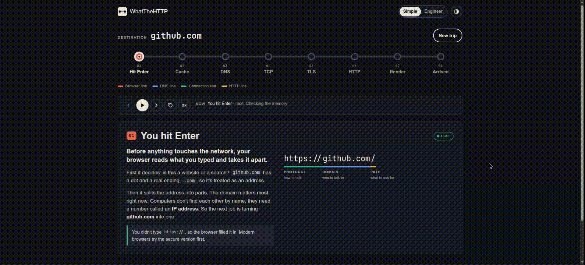

# WhatTheHTTP: what happens when you type a URL and hit Enter

**An interactive, animated walkthrough of what your browser does when you open a website: the DNS lookup, the TCP handshake, the TLS handshake, the HTTP request and response, and page rendering. It uses real DNS data for any site you type.**

[](https://majeed69.github.io/whatthehttp/)
[](LICENSE)


**Try it live:** [majeed69.github.io/whatthehttp](https://majeed69.github.io/whatthehttp/)
Or jump straight into a trip: [google.com](https://majeed69.github.io/whatthehttp/?site=google.com) · [github.com](https://majeed69.github.io/whatthehttp/?site=github.com) · [wikipedia.org](https://majeed69.github.io/whatthehttp/?site=wikipedia.org)



---

## Contents

- [What is WhatTheHTTP?](#what-is-whatthehttp)
- [What happens when you type google.com and press Enter?](#what-happens-when-you-type-googlecom-and-press-enter)
- [Features](#features)
- [Live data vs explained steps](#live-data-vs-explained-steps)
- [How it works](#how-it-works)
- [Run it locally](#run-it-locally)
- [Host your own copy on GitHub Pages](#host-your-own-copy-on-github-pages)
- [FAQ](#faq)
- [What I learned](#what-i-learned)
- [License](#license)

---

## What is WhatTheHTTP?

WhatTheHTTP is a free, browser based visualizer for the classic interview question: **"What happens when you type google.com into your browser and press Enter?"**

You type any domain. A small train travels along a metro style map and stops at eight stations, one for each thing your browser does to load a page. At each stop you get a plain language explanation, and if you switch to Engineer mode, the raw details: DNS records, packet flags, TLS messages and HTTP headers.

It's built for:

- **Students** learning computer networking and how the web works
- **Beginners** who want to understand DNS, TCP, TLS and HTTP without reading an RFC
- **People preparing for interviews** in networking, cloud, DevOps, SRE, IT support and web development
- **Teachers** who want a live demo to show in class



---

## What happens when you type google.com and press Enter?

Here's the short version of the answer, the same one WhatTheHTTP animates.

1. **The browser reads the URL.** It decides whether you typed an address or a search, adds `https://` if you left it out, and splits the URL into the protocol, the domain (`google.com`) and the path (`/`).
2. **It checks the caches.** The browser looks in its own DNS cache, then asks the operating system, which checks its cache and the hosts file. If a fresh answer is already there, the DNS step is skipped.
3. **DNS lookup.** The device asks a recursive resolver, usually your router, your internet provider, or a public one like 1.1.1.1. If the resolver hasn't cached the answer, it asks a **root server**. The root server points it to the **.com TLD servers**, and those point it to **google.com's authoritative name servers**, which reply with the IP address (an **A** record for IPv4, **AAAA** for IPv6). The answer comes with a **TTL** that says how long it can be cached.
4. **TCP handshake.** The browser opens a connection to that IP on port 443 with three messages: **SYN, SYN-ACK, ACK**. This costs one round trip.
5. **TLS handshake.** The browser and server agree on encryption. The server sends its **certificate**, and the browser checks that it matches the domain, is signed by a trusted certificate authority, and hasn't expired. Both sides derive the same secret key without ever sending it. With TLS 1.3 this takes one round trip.
6. **HTTP request and response.** The browser sends `GET /` with headers like `Host` and `Accept`. The server replies with a status code (`200 OK`, or often a `301` redirect first), response headers, and the HTML.
7. **Rendering.** The browser parses the HTML into the **DOM** and the CSS into the **CSSOM**, fetches scripts, images and fonts, then builds the render tree and does **layout**, **paint** and **compositing**. That's when you see the page.

Modern browsers often use **HTTP/2** or **HTTP/3** for step 6. HTTP/3 runs over **QUIC** on UDP, which replaces the separate TCP handshake. WhatTheHTTP explains both.

---

## Features

- **Real DNS lookups** for any public domain, with IPv4 and IPv6 addresses, CNAME chains, TTLs, DNSSEC status and authoritative name servers
- **A real, approximate round trip time** measured from your browser to the site
- **8 animated stations:** URL parsing, caches, DNS, TCP, TLS, HTTP, rendering, and a summary
- **Simple mode** for plain explanations, and **Engineer mode** for raw records, packet details and headers
- **Playback controls:** play, pause, next, previous, replay, and 1x or 2x speed
- **A shareable summary card:** download your result as a PNG
- **Shareable links:** `?site=github.com` starts a trip straight away
- **Kind error messages** that teach: NXDOMAIN, SERVFAIL, domains with no address, and an offline state
- **Accessible:** full keyboard control, screen reader announcements, and a calmer version for `prefers-reduced-motion`
- **Light and dark themes** that follow your system, with a manual toggle
- **Mobile first:** the metro line runs vertically on phones
- **Private:** no cookies, no analytics, no tracking, and no third party fonts

---

## Live data vs explained steps

A web page isn't allowed to see raw network packets, and that's a good thing. So every station carries a badge that tells you what's real.

| Station | Badge | Where the data comes from |
| --- | --- | --- |
| You hit Enter | **Live** | Your browser's own URL parser (`new URL()`) |
| Checking the memory | Explained | Pages can't read your browser or OS caches |
| DNS lookup | **Live** | [Cloudflare DNS over HTTPS](https://developers.cloudflare.com/1.1.1.1/encryption/dns-over-https/make-api-requests/dns-json/), falling back to [Google Public DNS](https://developers.google.com/speed/public-dns/docs/doh/json) |
| TCP handshake | Explained, plus live timing | Real IP and port. The round trip time is measured with `fetch()` and `performance.now()` |
| TLS handshake | Explained | How TLS 1.3 works, shown with your real domain and IP |
| HTTP request | Explained | Your browser's real User-Agent and language. The response headers are typical examples |
| Rendering | Explained | How browsers render pages |
| Summary | **Live** | Your real IP, TTL, resolver and timing |

---

## How it works

No frameworks, no build step, no backend. It's just four files:

```
index.html   page structure and Content Security Policy
style.css    design tokens, metro map, diagrams, mobile and reduced motion styles
app.js       DNS lookup, timing, playback, station content, PNG export
README.md    this file
```

A few technical details:

- **DNS over HTTPS (JSON API).** The app sends A, AAAA and CNAME queries in parallel, plus a short NS lookup to find the authoritative servers. Real DNS answers like NXDOMAIN are shown as they are. The fallback resolver is only used when the first one can't be reached.
- **Round trip timing.** One cold and three warm `no-cors` requests to `/favicon.ico`. The cold request includes connection setup. The fastest warm request is close to one round trip.
- **Layout independent metro map.** CSS places the stations. JavaScript measures them with `getBoundingClientRect()` and draws the track between them, so one piece of code works for the horizontal (desktop) and vertical (mobile) layouts.
- **CSS driven animation.** Keyframes with `--i` and `--speed` custom properties handle timing and 2x mode. Pausing uses `animation-play-state`.
- **Canvas API** draws the summary card for the PNG download, with no libraries.
- **Strict Content Security Policy:** only the site's own script and styles are allowed to run.

---

## Run it locally

```bash
git clone https://github.com/majeed69/whatthehttp.git
cd whatthehttp
python3 -m http.server 8000
```

Then open [http://localhost:8000](http://localhost:8000). Any static file server works, for example `npx serve .`.

---

## Host your own copy on GitHub Pages

1. Fork this repository.
2. Go to **Settings**, then **Pages**.
3. Set **Source** to **Deploy from a branch**, then pick `main` and `/ (root)`.
4. Your copy will be live at `https://<your-username>.github.io/whatthehttp/` within a couple of minutes.

---

## FAQ

### Is the DNS data real?

Yes. Your browser sends a real DNS query to Cloudflare's public resolver over HTTPS, or to Google Public DNS if Cloudflare can't be reached. The IP addresses, CNAME records and TTLs you see are the actual answer.

### Why is the IP different from what I get with `nslookup` or `dig`?

Big sites hand out different IP addresses depending on where the question comes from, to send you to a nearby server and spread out traffic. Your computer usually asks your router or internet provider's resolver, while WhatTheHTTP asks Cloudflare. Both answers are correct.

### Can a website see TCP or TLS packets?

No. Browsers don't let web pages open raw sockets or inspect another site's connection. That's why those stations are marked **Explained**: they show how the handshakes work, using your real domain and IP.

### What does NXDOMAIN mean?

NXDOMAIN means "non-existent domain". It's a real DNS answer saying the name isn't set up anywhere, usually because of a typo or an expired domain. Try a made up domain in WhatTheHTTP to see it explained.

### Why doesn't it work on my office or school network?

Some networks block DNS over HTTPS on purpose. If neither Cloudflare nor Google can be reached, the app tells you so and offers a retry.

### Does it collect any data?

No. There are no cookies, no analytics and no tracking scripts. The only requests go to the DNS resolvers and to the site you typed, for the timing test. Your theme choice is saved in your own browser and nowhere else.

### Can I use it for teaching?

Yes, please. It's MIT licensed. Links like `https://majeed69.github.io/whatthehttp/?site=example.com` open a specific trip straight away, which works well in slides.

---

## What I learned

- A DNS answer carries much more than an IP: status codes, the DNSSEC AD flag, CNAME chains, and the SOA record that says which zone answered.
- NXDOMAIN is a valid answer, not an error. It gets cached too.
- Browsers deliberately limit what a page can measure. Timing a `no-cors` request still tells you something real.
- Connection reuse is why the second request to a site is so much faster than the first.
- Light in fibre travels about 200 km per millisecond, so a 20 ms round trip means the server is at most about 2,000 km away.
- Measuring positions and drawing between them was simpler than maintaining two separate map layouts.
- Writing simply is harder than writing correctly.

---

## Contributing

Spotted something technically wrong, or have an idea for a station? [Open an issue](https://github.com/majeed69/whatthehttp/issues). Corrections are especially welcome, because getting the details right is the whole point.

## License

[MIT](LICENSE). Use it, learn from it, build on it. A credit back here is appreciated.

## Author

Built by **Majeed Mujawar** ([@majeed69](https://github.com/majeed69)), with a lot of coffee.

DNS answers by [Cloudflare 1.1.1.1](https://1.1.1.1/) and [Google Public DNS](https://developers.google.com/speed/public-dns).
